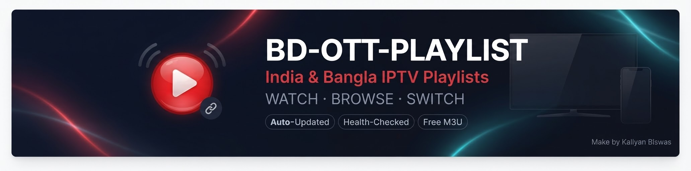
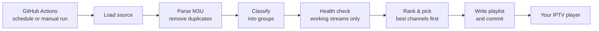

<p align="center">
  
</p>

# Make by Kallyan Biswas
# Facebook: Www.Facebook.com/kallyan.biswas.29

<p align="center">
  <a href="https://github.com/Mrbotrx/BD-OTT-PLAYLIST/raw/main/india/India_vip.m3u">
    
  </a>
  <a href="https://t.me/iptvlinksm3u8">
    
  </a>
  <a href="https://www.facebook.com/kallyan.biswas.29">
    
  </a>
</p>

<h1 align="center">BD-OTT-PLAYLIST</h1>

<p align="center">
  <b>Auto-updating IPTV playlists for India & Bangladesh</b><br/>
  WATCH · BROWSE · SWITCH
</p>

<p align="center">
  
  
  
  
</p>

<p align="center">
  <a href="https://github.com/Mrbotrx/BD-OTT-PLAYLIST/actions/workflows/ind_bot.yml"></a>
  <a href="https://github.com/Mrbotrx/BD-OTT-PLAYLIST/actions/workflows/update.yml"></a>
</p>

<p align="center">
  <a href="#-quick-start"><b>Quick start</b></a> ·
  <a href="#-playlists"><b>Playlists</b></a> ·
  <a href="#%EF%B8%8F-setup-guide"><b>Setup</b></a> ·
  <a href="#%EF%B8%8F-configuration"><b>Configuration</b></a> ·
  <a href="#-troubleshooting"><b>Troubleshooting</b></a> ·
  <a href="#-বাংলা-গাইড"><b>বাংলা</b></a>
</p>

---

## ✨ Why this project

- **Fully automatic.** GitHub Actions rebuilds every playlist on a schedule. No server to maintain.
- **Only working links.** Every stream is health-checked before it is written, so dead channels are removed.
- **Organised for you.** Channels are sorted into clear groups: Jalsha, Zee, Star, Entertainment, Movies, Sports, News, Bangla and more.
- **Your favourites first.** Jalsha, Zee, Star and Entertainment (Sony, Sun, Colors, Gemini, Vijay) appear at the top.
- **Fast after the first run.** Working channels are cached for 3 hours, so most checks are skipped.
- **Works everywhere.** Use it in VLC, TiviMate, OTT Navigator, IPTV Smarters, Kodi and other M3U players.

---

## 🔄 How it works



---

## 🚀 Quick start

1. Copy a playlist link from the table below.
2. In your IPTV player, choose **Add playlist → M3U URL** and paste the link.
3. Open any group and start watching.

> The playlist refreshes automatically on GitHub. Reload your player to see the newest list.

---

## 📺 Playlists

| Playlist | Updates | Playlist link |
|---|---|---|
| **India + Bangla VIP** | Every 3 hours | `https://raw.githubusercontent.com/Mrbotrx/BD-OTT-PLAYLIST/main/india/India_vip.m3u` |
| **AKASH OTT** | About every 58 minutes | `https://raw.githubusercontent.com/Mrbotrx/BD-OTT-PLAYLIST/main/kb_go_playlist.m3u8` |

---

## ⚙️ Setup guide

Follow these steps once to run the project on your own GitHub account.

### Step 1 — Get the code

```bash
git clone https://github.com/Mrbotrx/BD-OTT-PLAYLIST.git
cd BD-OTT-PLAYLIST
```

You can also click **Fork** on GitHub and clone your copy.

### Step 2 — Allow workflows to commit

Open **Settings → Actions → General → Workflow permissions**, choose **Read and write permissions**, and save.

### Step 3 — Run once

Open the **Actions** tab, choose a workflow, and click **Run workflow**:

- `IND.bot - India + Bangla VIP Auto Update`
- `AKASH OTT Auto Playlist`

A green ✅ means the playlist was built and committed.

### Step 4 — Connect your player

Use the links in the [Playlists](#-playlists) table.

-

## 🩺 Troubleshooting

<details>
<summary><b>A group is empty</b></summary>

- Read the run log: the `candidates` and `working/picked` lines show each group's numbers.
- Many streams are geo-blocked and cannot be reached from GitHub's servers. This is expected.
</details>

<details>
<summary><b>Push rejected: "non-fast-forward"</b></summary>

Two workflows pushed at the same time. IND.bot retries automatically. If it still fails, run it again.
</details>

<details>
<summary><b>Playlist is late</b></summary>

GitHub's scheduler can start jobs several minutes late, especially at the top of the hour.
</details>

<details>
<summary><b>"Invalid workflow file" error</b></summary>

YAML is sensitive to indentation. Use spaces, not tabs, and paste the full file again.
</details>

---

## 🇧🇩 বাংলা গাইড

**দ্রুত শুরু:**

1. Repository-টি **Fork** বা **Clone** করুন।
2. **Settings → Actions → General → Workflow permissions**-এ **Read and write permissions** চালু করুন।
3. **Actions** ট্যাব থেকে workflow গুলো একবার **Run workflow** দিয়ে চালান।
4. প্লেয়ারে এই লিংকটি M3U URL হিসেবে যোগ করুন:

```text
https://raw.githubusercontent.com/Mrbotrx/BD-OTT-PLAYLIST/main/india/India_vip.m3u
```

**Telegram:** [t.me/iptvlinksm3u8](https://t.me/iptvlinksm3u8)

**সমস্যা হলে:** Troubleshooting অংশটি দেখুন।

---

## ⚠️ Disclaimer

This project organises and health-checks IPTV playlists. It does not host, create or own any channel or content. Use only streams you are legally allowed to access. The maintainers are not responsible for third-party content, availability or copyright decisions. Check the laws in your country before use.

---

## 🙏 Credits

**Made by:** Kallyan Biswas
**Facebook:** [Www.Facebook.com/kallyan.biswas.29](https://www.facebook.com/kallyan.biswas.29)
**Telegram:** [t.me/iptvlinksm3u8](https://t.me/iptvlinksm3u8)
**Team:** KB Cyber Team
**Repository:** [Mrbotrx/BD-OTT-PLAYLIST](https://github.com/Mrbotrx/BD-OTT-PLAYLIST)

If this project helps you, please give it a ⭐. Thank you!

---

<p align="center"><sub>Make by Kallyan Biswas · Www.Facebook.com/kallyan.biswas.29</sub></p>
